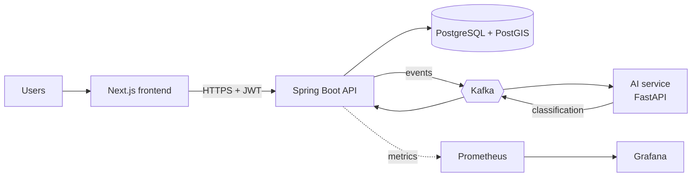

<p align="center">
  <picture>
    <source media="(prefers-color-scheme: dark)" srcset="docs/assets/reliefgrid-logo-transparent.png">
    
  </picture>
</p>

<p align="center">
  <b>Disaster relief coordination on one live map.</b><br>
  Report needs, match them with supplies and volunteers, and let AI triage what matters first.
</p>

<p align="center">
  
  
  
  
</p>

---

## The problem

During floods and landslides, help gets wasted. Donations pile up in one place while another
has none, volunteers don't know where to go, and needs are scattered across WhatsApp and
Facebook posts. ReliefGrid puts reports, supplies, and volunteers on one trusted map so
coordinators can act in minutes.

## Features

- **Live map** of needs and supply points, colored by urgency
- **AI triage**: urgency and need type are classified from free-text reports
- **Role-based workflow** for citizens, volunteers, NGOs, coordinators, and admins
- **Smart matching**: nearest supply points that hold the needed item (PostGIS)
- **Volunteer tasks** with safe accept/complete handling (no double-booking)
- **Notifications** on status changes and task assignments
- **Demand forecasting** per need type for coordinators
- **Public status page** with aggregate counts only, no personal data
- **Three languages**: English, Sinhala, Tamil
- **Offline-friendly PWA** shell, installable on a phone
- **Audit log** of every state change

## Architecture



The backend is a modular monolith (package by feature) with one separate AI microservice.
Services communicate through Kafka, so an AI or notification outage never blocks a
citizen from submitting a request. Details: [`docs/architecture.md`](docs/architecture.md).

## Tech stack

| Layer | Technology |
|---|---|
| Frontend | Next.js, TypeScript, Tailwind CSS, MapLibre GL, next-intl |
| Backend | Spring Boot 4, Java 21, Spring Security, Flyway |
| Data | PostgreSQL 17 + PostGIS |
| Messaging | Apache Kafka |
| AI / ML | Python, FastAPI, scikit-learn |
| Delivery | Docker, GitHub Actions, Jenkins, Kubernetes (kustomize) |
| Infrastructure | Terraform on AWS (EKS, RDS, MSK, ECR, Route 53) |
| Observability | Prometheus, Grafana |

## Quick start

Requires Docker with Compose v2.

```bash
git clone https://github.com/Sadew-Upendra/ReliefGrid.git
cd ReliefGrid
./scripts/dev-up.sh
./scripts/seed-admin.sh admin@reliefgrid.com 'admin@reliefgrid123'
```

| Service | URL |
|---|---|
| Frontend | http://localhost:3000 |
| Backend API | http://localhost:8080 |
| AI service | http://localhost:8000 |

Register a citizen account at `/register`, submit a request containing the word "trapped",
and the AI service will raise its urgency to critical within seconds. Stop everything with
`./scripts/dev-down.sh`. For native development per service, see
[`docs/running-locally.md`](docs/running-locally.md).

## Project structure

```
reliefgrid/
├── frontend/      Next.js app (i18n, PWA)
├── backend/       Spring Boot API
├── ai-service/    FastAPI: triage and forecasting
├── infra/         docker, kafka, grafana, k8s, terraform, jenkins
├── scripts/       dev-up, dev-down, seed-admin
├── docs/          architecture, security, runbooks, ADRs
└── CHANGELOG.md
```

## Documentation

| | |
|---|---|
| [Architecture](docs/architecture.md) | system design, data model, Kafka topics |
| [API spec](docs/api-spec.yaml) | OpenAPI definition |
| [Running locally](docs/running-locally.md) | Docker and native setup, troubleshooting |
| [Security](docs/security.md) | auth, rate limiting, secrets, scanning |
| [AWS deployment](docs/deployment-aws.md) | Terraform to live environment |
| [Release guide](docs/release-guide.md) | versioning, tagging, rollback |
| [Decision records](docs/adr) | why key choices were made |

## Contributing

Branch from `main`, use [Conventional Commits](https://www.conventionalcommits.org)
(`feat(request): ...`, `fix(task): ...`), and open a pull request. CI must pass before merge.

## License

Released under the [MIT License](LICENSE).
