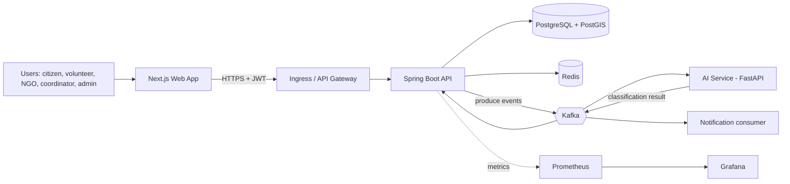
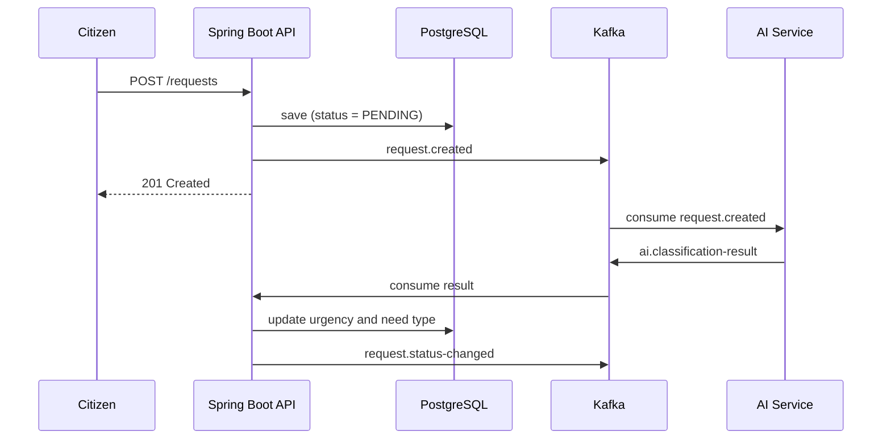
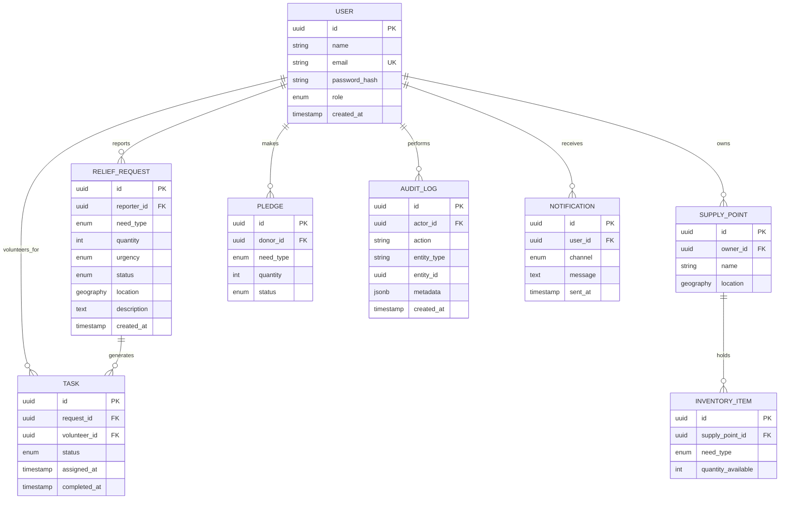

# ReliefGrid Architecture

## 1. Overview
A **modular monolith** (Spring Boot) plus one **AI microservice** (FastAPI), connected through **Kafka**. PostgreSQL with PostGIS stores data; Redis handles caching and rate limiting.

## 2. System Diagram

## 3. Backend Modules
| Module | Responsibility |
|---|---|
| auth | Registration, login, JWT and refresh tokens, RBAC |
| requests | Relief requests: type, quantity, urgency, location, status |
| inventory | Supply points, inventory items, pledges |
| tasks | Volunteer task assignment and completion |
| matching | Nearest supply and volunteer suggestions (PostGIS) |
| audit | Immutable log of every state change |
| notifications | Email/SMS dispatch from Kafka events |

## 4. Request Lifecycle

## 5. Data Model

**Enums**
- `role`: CITIZEN, VOLUNTEER, NGO, COORDINATOR, ADMIN
- `need_type`: FOOD, WATER, MEDICINE, SHELTER, RESCUE, OTHER
- `urgency`: LOW, MEDIUM, HIGH, CRITICAL
- `request status`: PENDING, VERIFIED, ASSIGNED, IN_PROGRESS, FULFILLED, REJECTED
- `task status`: OPEN, ACCEPTED, COMPLETED, CANCELLED

## 6. Kafka Topics
| Topic | Producer | Consumers |
|---|---|---|
| request.created | API | AI service, analytics |
| ai.classification-result | AI service | API |
| request.status-changed | API | Notifications, analytics |
| task.assigned | API | Notifications |

## 7. Security Summary
- JWT access tokens (short-lived) plus refresh tokens
- Role-based access control on every endpoint
- Input validation, rate limiting (Redis), CORS allow-list
- Passwords hashed with BCrypt or Argon2
- Audit log for all state changes
- Secrets via environment/secret manager, never in the repo

## 8. Non-Functional Targets
- Map updates visible in under 2 seconds
- Report submission never blocked by AI (async design)
- Everything containerized and reproducible from `docker compose up`
- API documented, core logic unit-tested, key flows integration-tested
